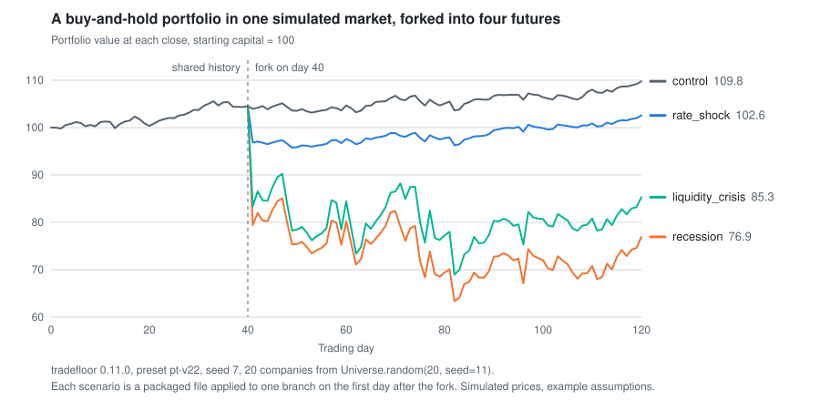

# tradefloor

tradefloor is a reproducible evaluation environment for financial AI agents.
It is a deterministic market simulator with a Rust core and a Python API.

[](https://github.com/simoncoombes/tradefloor/actions/workflows/determinism.yml)
[](https://pypi.org/project/tradefloor/)
[](https://pepy.tech/projects/tradefloor)
[](https://crates.io/crates/tradefloor)
[](#license)
[](https://www.python.org/downloads/)

<picture>
  <source media="(prefers-color-scheme: dark)" srcset="https://raw.githubusercontent.com/simoncoombes/tradefloor/main/examples/fork-futures/figure/fork-futures-dark.svg">
  
</picture>

The figure is engine output on one seed, drawn by
[`examples/fork-futures/fork_futures.py`](https://github.com/simoncoombes/tradefloor/blob/main/examples/fork-futures/fork_futures.py).

## Purpose

A backtest replays one history. A language model may have read that history
during training, and an order placed in a backtest leaves the replayed price
where it was. tradefloor computes every price from a seed. So an agent meets
a market that no dataset holds, its orders move the price, and a running
market forks into branches that share one past. The prices are simulated,
and a result here says how an agent behaved in the model.
[Limits](#limits) names what to check before a result is used, and the
documentation is at https://docs.tradefloor.dev.

## Install

```
pip install tradefloor
```

There are wheels for Linux, macOS and Windows on CPython 3.11+, and no
dependencies. The same engine is a Rust crate (`cargo add tradefloor`).
Optional extras add the MCP server (`tradefloor[mcp]`), Arrow output
(`tradefloor[arrow]`), the Gymnasium environment (`tradefloor[rl]`) and one
extra per agent framework.

## A first run

```python
import tradefloor as tf

universe = tf.Universe.random(40, seed=111)

spec = tf.StrategySpec.momentum(lookback_days=1.0, top_k=5)
scores = tf.evaluate({"mine": spec}, seed=7, universe=universe, days=10)

scores["mine"].return_pct            # what it made
scores["mine"].impact_bps            # what its own footprint cost
scores["mine"].strategy_fingerprint  # sha256, cite this
scores["mine"].errors                # each step that raised or was refused
scores["mine"].sharpe                # annualised, from the daily closes
scores["mine"].time_in_market        # share of steps holding a position
```

That result comes from one random market, so it says as much about the seed
as about the strategy. `tf.rank` compares strategies across many seeds with a
paired sign test ([docs/AGENTS.md](https://github.com/simoncoombes/tradefloor/blob/main/docs/AGENTS.md)).

## Forking a market

A `tf.World` holds a market, an agent and its portfolio. `world.run` advances
it, `world.fork` returns independent branches that share its history, and
`tf.compare` reads two branches side by side. This block runs the market in
the figure above and applies the packaged `rate_shock` scenario to one
branch:

```python
import tradefloor as tf

universe = tf.Universe.random(20, seed=11)
world = tf.World(seed=7, universe=universe,
                 agent=tf.baselines.BuyAndHold())
world.run(days=40)                          # a shared history

control, shock = world.fork("control", "rate_shock")
same = tf.agree(control, shock)             # checked before any change
shock.apply(tf.Scenario.load("rate_shock"), at=0)

control.run(days=80)
shock.run(days=80)
print(same)
print(tf.compare(control, shock, agreement=same).render())
```

`tf.agree` runs nine checks that two branches hold the same state, and
[docs/API.md](https://github.com/simoncoombes/tradefloor/blob/main/docs/API.md) shows the printed comparison, the scenarios and the rate-shock demo.

## Further reading

| | |
|---|---|
| [docs/AGENTS.md](https://github.com/simoncoombes/tradefloor/blob/main/docs/AGENTS.md) | writing, scoring and comparing agents, the framework adapters and the sandbox limits |
| [examples/README.md](https://github.com/simoncoombes/tradefloor/blob/main/examples/README.md) | the thirteen numbered examples, the studies and the starter projects |
| [examples/integrations/](https://github.com/simoncoombes/tradefloor/tree/main/examples/integrations) | adapters for a plain callable, the OpenAI Agents SDK, the Anthropic SDK, PydanticAI, LangGraph and FinRobot, each run offline with no API key |
| [docs/MCP.md](https://github.com/simoncoombes/tradefloor/blob/main/docs/MCP.md) | the MCP server: `pip install "tradefloor[mcp]"`, then `claude mcp add tradefloor -- tradefloor-mcp`, with entries for Claude Desktop, Cursor and VS Code |
| [`tradefloor ci compare`](https://github.com/simoncoombes/tradefloor/blob/main/python/tradefloor/ci.py) | a baseline and a candidate agent on the same seeds for a pull request, with a [reusable workflow](https://github.com/simoncoombes/tradefloor/blob/main/.github/workflows/evaluate.yml) |
| [docs/API.md](https://github.com/simoncoombes/tradefloor/blob/main/docs/API.md) | the package contents, price attribution with `engine.truth()`, forks and scenarios |
| [docs/REALISM.md](https://github.com/simoncoombes/tradefloor/blob/main/docs/REALISM.md) | the realism results and every measured limit |
| [docs/REPRODUCIBILITY.md](https://github.com/simoncoombes/tradefloor/blob/main/docs/REPRODUCIBILITY.md) | what replays exactly, across platforms, releases and restored state |
| [docs/MODEL.md](https://github.com/simoncoombes/tradefloor/blob/main/docs/MODEL.md) | the model as equations, with every coefficient's value on the default preset and where it came from |
| [docs/STATISTICS.md](https://github.com/simoncoombes/tradefloor/blob/main/docs/STATISTICS.md) | the named sets of realism statistics |
| [docs/SUPPORT.md](https://github.com/simoncoombes/tradefloor/blob/main/docs/SUPPORT.md) | which release lines get fixes, and for how long |
| [docs/EMBEDDING.md](https://github.com/simoncoombes/tradefloor/blob/main/docs/EMBEDDING.md) | driving the Rust engine from a game or another host, and how much flow of its own the model takes |
| [ROADMAP.md](https://github.com/simoncoombes/tradefloor/blob/main/ROADMAP.md) | planned work |

<!-- mcp-name: io.github.simoncoombes/tradefloor -->

Tradefloor Bench, a benchmark for financial AI agents built on this engine,
is in preparation. So far only baseline strategies have been run on it. No
language model has been scored, so no model results exist yet.
[ROADMAP.md](https://github.com/simoncoombes/tradefloor/blob/main/ROADMAP.md)
lists the planned pilot and the public version after it.

## Limits

- The prices are simulated. On pt-v22, the default, 19 of the 19 statistics
  of the one-year table are inside the range real markets show over a year,
  and [docs/REALISM.md](https://github.com/simoncoombes/tradefloor/blob/main/docs/REALISM.md) has every measured limit.
- The read-only market view guards only against accidents, and agents in one
  `tf.evaluate` or `tf.rank` call share one Python process. Run each agent
  you did not write in its own process ([docs/AGENTS.md](https://github.com/simoncoombes/tradefloor/blob/main/docs/AGENTS.md)).
- A result depends on its seed and its preset, so publish both with the
  version. The default preset is `pt-v22`, and
  [docs/REPRODUCIBILITY.md](https://github.com/simoncoombes/tradefloor/blob/main/docs/REPRODUCIBILITY.md) says what replays exactly.

## Contributing

[CONTRIBUTING.md](https://github.com/simoncoombes/tradefloor/blob/main/CONTRIBUTING.md) explains how to build and test the project.
Its main rule is that any change to the simulated trajectory is a breaking
change, however small, so a model change ships as a new preset.
[CODE_OF_CONDUCT.md](https://github.com/simoncoombes/tradefloor/blob/main/CODE_OF_CONDUCT.md) sets the conduct expected in the project's spaces.
Report a vulnerability through GitHub's
[security advisory form](https://github.com/simoncoombes/tradefloor/security/advisories/new),
and [SECURITY.md](https://github.com/simoncoombes/tradefloor/blob/main/SECURITY.md) says what is in scope.
Bugs and questions go to [GitHub issues](https://github.com/simoncoombes/tradefloor/issues).

## Citing tradefloor

Cite the version you ran and name the preset. The same version can run
several presets, and results depend on the preset.
[CITATION.cff](https://github.com/simoncoombes/tradefloor/blob/main/CITATION.cff)
carries the same details, and GitHub's "Cite this repository" button reads
it. In the text, say which model you used, for example:
"tradefloor 0.11.0, preset pt-v22, specified in its docs/MODEL.md".

```bibtex
@software{tradefloor,
  author  = {Coombes, Simon},
  title   = {tradefloor: a deterministic market simulator with a limit order book},
  version = {0.11.0},
  year    = {2026},
  url     = {https://github.com/simoncoombes/tradefloor},
  note    = {Model preset pt-v22}
}
```

## License

tradefloor is licensed under MIT OR Apache-2.0, at your option. See
[LICENSE-MIT](https://github.com/simoncoombes/tradefloor/blob/main/LICENSE-MIT)
and
[LICENSE-APACHE](https://github.com/simoncoombes/tradefloor/blob/main/LICENSE-APACHE).
GitHub's sidebar reads Apache-2.0 because its license detection picks one
file and stops. The grant that applies is the dual one, stated in
`pyproject.toml`, `rust/Cargo.toml` and this section.
